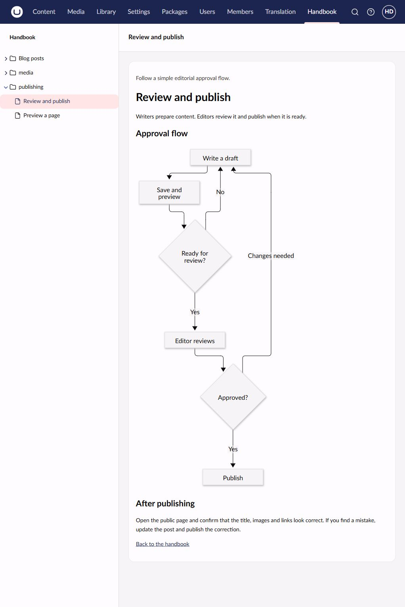

# Handbook

Display your own Markdown documentation inside the Umbraco backoffice.



This repository contains the package, native backoffice client and a runnable Clean demo. For installation and writing documentation, see the [NuGet guide](docs/nuget-readme.md). The [Marketplace guide](umbraco-marketplace-readme.md) is for package users.

## Repository structure

- `src/Umbraco.Community.Handbook/`: library, API and migration.
- `src/Umbraco.Community.Handbook/Client/`: TypeScript client and generated OpenAPI bindings.
- `tests/`: filesystem and security regression tests; client tests live alongside their modules.
- `demo/Handbook.TestSite/`: unattended SQLite testsite with Clean and original sample documentation.
- `docs/`: user guide, screenshots, design and implementation plan.
- `buildTransitive/`: automatic appsettings schema registration.

## Run locally

Use .NET 11, Node.js 24.13 or newer and npm 11 or newer. `global.json` selects the .NET 11 SDK, with an optional project-local installation in `.dotnet/`.

```sh
cd src/Umbraco.Community.Handbook/Client
npm ci --legacy-peer-deps
npm run build
cd ../../..
dotnet run --project demo/Handbook.TestSite
```

Open http://localhost:5180/umbraco and sign in with `admin@example.com`. At first Development startup, the site creates a random password and image signing key in the git-ignored `demo/Handbook.TestSite/appsettings.Local.json`. Read `Umbraco:CMS:Unattended:UnattendedUserPassword` in that local file for the password. It is preserved on later starts. No credentials are committed. Never deploy this demo or its development settings as a production site.

The local launch profile sets Development. Umbraco installs itself, then installs Clean and grants Handbook access. The sample documentation is in `demo/Handbook.TestSite/Documentation`. If Clean's frontend has not been published by its installer, publish the home page and save a dictionary item as described by Clean. The handbook works independently of frontend publication.

The demo uses Umbraco 19 RC1, Clean 19 beta and ImageSharp 4, and is built in Debug for local use. Building the demo in Release requires a valid Six Labors license. This requirement belongs to the demo's image processing dependency, which is not shipped by Handbook itself.

Before starting the upgraded demo against an existing v18 database, back it up. Umbraco 18 cannot open a database upgraded by v19. Review the [Umbraco 19 upgrade notes](https://docs.umbraco.com/umbraco-cms/19.latest/get-started/upgrading-and-migrating/version-specific), including canonical Base64 imaging keys, moved configuration and property editor migrations.

## Build and verify

```sh
dotnet test tests/Umbraco.Community.Handbook.Tests
cd src/Umbraco.Community.Handbook/Client
npm test
npm run build
cd ../../..
dotnet pack src/Umbraco.Community.Handbook -c Release -o artifacts
```

The client must be built before building the site or packing. Compiled assets are served through Razor Class Library static web assets. Inspect the nupkg to confirm client JS, manifest, readme, icon, schema and schema target are included, while demo data and credentials are absent.

To regenerate the API client, run the testsite and execute `npm run generate-client` in Client. Commit generated bindings so package users do not need client generation or Node.js.

## Version lines and releases

`main` targets Umbraco 19, `v18/main` targets Umbraco 18 and `v17/main` targets Umbraco 17. All publish `Umbraco.Community.Handbook`. Versions 19.x use `[19.0.0-rc1,20.0.0)`, versions 18.x use `[18.0.0,19.0.0)` and versions 17.x use `[17.0.0,18.0.0)`. Use the corresponding client major and Clean 19 beta/8.x/7.x in the demo. NuGet can warn rather than reject an incompatible dependency override in a consuming project.

Tag `v19.0.0-beta01` from `main`, v18 releases from `v18/main` and v17 releases from `v17/main`. The tag without `v` becomes the NuGet package version. The publish workflow builds the client, tests, packs, validates package identity/range/contents and uses NuGet trusted publishing. Configure a nuget.org trust policy for owner `skttl`, repo `umbraco-handbook`, workflow `publish.yml`, environment `release`. Create that GitHub environment with `NUGET_USER` set to the owning NuGet account name. No permanent NuGet API key is required. Never reuse a published package version.

## License

MIT. The icon is Lucide `book-open`; see [third-party notices](THIRD_PARTY_NOTICES.md).

