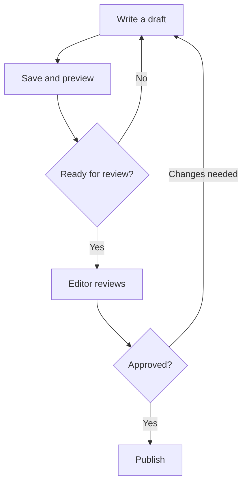

# Review and publish

Writers prepare content. Editors review it and publish when it is ready.

## Approval flow

## After publishing

Open the public page and confirm that the title, images and links look correct.
If you find a mistake, update the post and publish the correction.

[Back to the handbook](../README.md)
